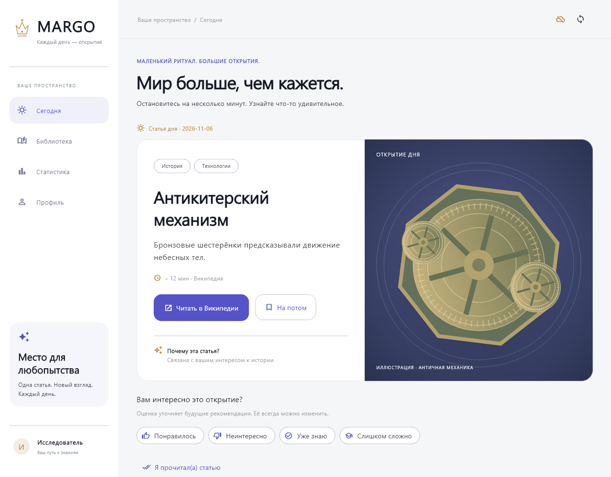
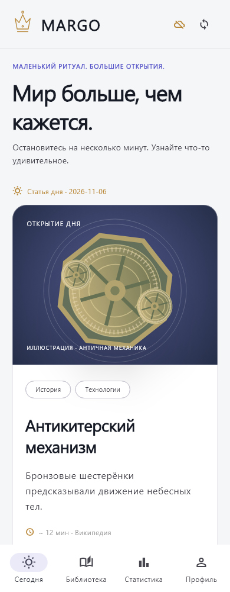
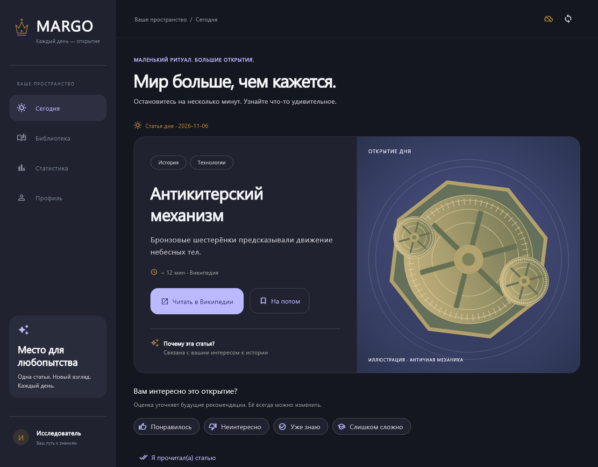

<div align="center">

# 👑 MARGO

**Каждый день — открытие.**

Персональный проводник по знаниям для Windows и Android.<br>
Одна статья в день, подобранная под ваши интересы, — и новый повод удивиться миру.


[Возможности](#возможности) · [Как попробовать](#как-попробовать) · [Разработка](#разработка) · [Документация](#документация)

</div>



<details>
<summary>Мобильный интерфейс и тёмная тема</summary>

<p align="center">
  
</p>



</details>

## Идея

MARGO помогает превратить любопытство в небольшую ежедневную привычку. Вы выбираете интересы, получаете карточку с кратким анонсом и переходите к полному тексту в Википедии. Сохраняйте находки, отмечайте прочитанное и оценивайте материалы — обратная связь влияет на следующие рекомендации.

Статья закрепляется за вашим днём с учётом часового пояса. Каждый пятый день включается режим открытий: возможность выйти за пределы привычных тем.

Название дано в честь королевы Марго, а символ приложения — золотая корона.

## Возможности

| | Что умеет MARGO |
| --- | --- |
| **Статья дня** | Персональный подбор по 20 направлениям, без повторов и с объяснением рекомендации |
| **Запас материалов** | Остаток по языкам в профиле, ежедневное пополнение через планировщик и экран, когда новые статьи закончились |
| **Обратная связь** | Четыре оценки: «Понравилось», «Неинтересно», «Уже знаю», «Слишком сложно» |
| **Личная библиотека** | История, избранное, поиск и фильтры |
| **Прогресс** | Отметки прочтения, статистика и календарь |
| **Два устройства** | Один аккаунт для Windows и Android, синхронизация действий и обработка конфликтов |
| **Доступ без сети** | Ранее загруженные карточки и очередь действий для последующей синхронизации |
| **Оформление** | Светлая, тёмная и системная темы, собственные шрифты, адаптивная навигация |
| **Контроль аккаунта и данных** | Восстановление и смена пароля, завершение остальных сессий, экспорт данных и удаление аккаунта |

Также доступны ежедневные локальные напоминания, не зависящие от загрузки статьи, и проверка обновлений. В release-сборках обновления загружаются автоматически, установка запускается пользователем.

> **Статус проекта:** рабочий прототип. Полный текст статей открывается в Википедии и требует интернета. Ограничения текущей версии перечислены [ниже](#текущие-ограничения).

## Как попробовать

### Без аккаунта

Откройте приложение и выберите **«Попробовать без аккаунта»**. В деморежиме доступны четыре встроенные карточки, статья-пример, избранное, оценки, статистика и настройки. Данные сохраняются между запусками отдельно от аккаунта. Новые рекомендации и уведомления в деморежиме не появляются.

### С аккаунтом

1. Установите или соберите клиент для своей платформы.
2. Создайте аккаунт, выберите интересы, язык и часовой пояс.
3. Сохраните профиль — сервер назначит первую статью.

| Платформа | Готовая сборка |
| --- | --- |
| **Windows** | `dist/MARGO-Setup-<версия>.exe` — установщик для текущего пользователя |
| **Windows Portable** | Распакуйте **весь** `dist/MARGO-Windows.zip` и запустите `margo.exe` |
| **Android 7.0+** | `dist/MARGO-Android.apk` — APK для прямой установки |

Каталог `dist/` создаётся при [сборке](#сборка) и не хранится в Git. Workflow [GitHub Actions](.github/workflows/ci.yml) настроен на публикацию артефактов Windows и debug APK Android после успешных сборок.

Адрес сервера задаётся при сборке параметром API_BASE_URL. Для скриптов сборки Android и Windows задайте переменные окружения API_BASE_URL и UPDATE_MANIFEST_URL. Для входа, новых рекомендаций и синхронизации сервер должен быть доступен. Для готовых сборок Flutter SDK и Node.js не нужны. Windows-установщик включает библиотеки Visual C++ x64; переносимой версии они могут потребоваться отдельно.

## Разработка

### Требования

- **Flutter 3.47.9 / Dart 3.13.7** — версия, указанная в CI; установка: [Flutter](https://docs.flutter.dev/install).
- **Python 3.12+** и **uv** — для сервера.
- **Windows:** Visual Studio с компонентами *Desktop development with C++*.
- **Android:** Android SDK, JDK 17 и принятые лицензии SDK.
- **Docker Compose** — для запуска с PostgreSQL.

Основной клиент написан на Flutter. Веб-прототип в `legacy/web/` сохранён как архив; Node.js нужен только для работы с ним.

### Локальный запуск

Из корня проекта запустите сервер в PowerShell:

```powershell
./scripts/start-backend.ps1
```

Скрипт установит зависимости через uv, применит миграции, заполнит начальный каталог и запустит API на `http://127.0.0.1:8000`. Документация API доступна по адресу `http://127.0.0.1:8000/docs`. Для простого локального запуска используется SQLite.

Во втором терминале запустите клиент:

```powershell
cd apps/margo_flutter
flutter pub get
flutter run -d windows --dart-define=API_BASE_URL=http://127.0.0.1:8000
```

Для эмулятора Android используйте адрес хост-машины `10.0.2.2`:

```powershell
flutter run -d <device-id> --dart-define=API_BASE_URL=http://10.0.2.2:8000
```

Идентификатор устройства можно получить командой `flutter devices`. Если Flutter установлен локально в `.tools/flutter`, из каталога клиента вместо `flutter` используйте `../../.tools/flutter/bin/flutter.bat`.

<details>
<summary>Общий сервер с PostgreSQL и развёртывание на VPS</summary>

Для синхронизации нескольких устройств используйте общий API и PostgreSQL. Из корня проекта:

```powershell
Copy-Item .env.example .env
# Задайте длинный случайный POSTGRES_PASSWORD в .env.
docker compose up --build
```

Compose запускает PostgreSQL, API и отдельный планировщик. Специальные символы пароля при подстановке в `DATABASE_URL` должны быть URL-encoded. Файл `.env` не должен попадать в Git.

Для VPS задайте в `.env` переменную `API_DOMAIN` без `https://`, направьте DNS-запись на сервер и откройте входящие TCP-порты 80 и 443. Caddy получает HTTPS-сертификат; API и PostgreSQL остаются во внутренней сети Docker.

```sh
docker compose -f docker-compose.yml -f docker-compose.vps.yml config --quiet
docker compose -f docker-compose.yml -f docker-compose.vps.yml up -d --build
curl --fail https://api.example.com/health
```

Замените `api.example.com` своим доменом. При сборке клиента задайте `--dart-define=API_BASE_URL=https://api.example.com`. Адрес манифеста обновлений задаётся отдельно — см. [инструкцию по обновлениям](docs/updates.md).

Встроенный rate limiter авторизации рассчитан на один API-процесс. Для нескольких процессов требуется общее ограничение запросов на reverse proxy.

Резервное копирование, проверка восстановления и Telegram/webhook-оповещения описаны
в [инструкции эксплуатации](docs/operations.md). Перед запуском VPS-конфигурации задайте
`MARGO_VERIFY_PASSWORD` и канал оповещений в `.env`.

</details>

### Сборка

Команды выполняются из корня проекта в PowerShell:

```powershell
# Windows: переносимый архив и установщик
./scripts/build-windows.ps1
./scripts/build-windows-installer.ps1

# Android: release APK для прямой установки
$env:MARGO_ANDROID_CERT_SHA256 = '47cdf9c65e2bd828b455430785c983ba6e50a804c8c06bd6f8c21e06900a52ad'
./scripts/build-android.ps1 -AllowLegacyDebugCertificate -PreviousApk .secrets/margo-signing/previous-0.4.3-11.apk
```

Результаты появятся в `dist/`. Для Windows-установщика нужны [Inno Setup 6](https://jrsoftware.org/isdl.php) и библиотеки Visual C++ x64 из Visual Studio. Для debug APK используйте `./scripts/build-android.ps1 -Mode debug`.

> Release-сборки требуют явно настроенной подписи. Схема хранения ключей, сохранение обновлений Android и настройка Windows Authenticode описаны в [инструкции по выпуску](docs/release-signing.md). Для существующего Android-канала нужен `-AllowLegacyDebugCertificate` и закреплённый отпечаток; для Windows — сертификат издателя.

### Проверки

```powershell
cd backend
uv sync --locked
uv run pytest
uv run alembic upgrade head
uv run alembic check

cd ../apps/margo_flutter
flutter pub get
flutter analyze
flutter test
```

Серверные тесты покрывают авторизацию, изоляцию данных, рекомендации, часовые пояса и конфликты синхронизации. Клиентские — очередь действий, деморежим, обрывы связи, жизненный цикл сессии, обновления и адаптивную компоновку.

[CI](.github/workflows/ci.yml) настроен на серверные тесты с PostgreSQL, анализ и тесты Flutter на Windows, а также сборки для Windows и Android.

## Устройство проекта

```text
apps/margo_flutter/    Клиент Flutter: экраны, локальная база, синхронизация
backend/              FastAPI, рекомендации, импорт, миграции и планировщик
docs/                 Подробная техническая документация
scripts/              Запуск сервера, сборка клиентов, подготовка обновлений
packaging/windows/    Конфигурация установщика Inno Setup
legacy/web/           Архив веб-прототипа
.github/workflows/    Проверки и сборки в CI
```

| Слой | Технологии |
| --- | --- |
| Клиент | Flutter, Dart, Riverpod, go_router, Dio |
| Данные на устройстве | SQLite, защищённое хранение токена, сохраняемая очередь операций |
| API | FastAPI, SQLAlchemy, Alembic, Argon2, отзываемые bearer-сессии |
| Серверные данные | PostgreSQL; SQLite для простого локального запуска |
| Развёртывание | Docker Compose, Caddy, отдельный процесс планировщика |

Рекомендации назначает сервер. Клиент хранит загруженные карточки и синхронизирует действия через API. UUID операций, идемпотентная обработка и версии отдельных полей позволяют обрабатывать повторы запросов и конфликты между устройствами. Подробности — в [описании синхронизации](docs/synchronization.md).

## Текущие ограничения

- Начальный каталог содержит **116 русскоязычных карточек** с авторскими анонсами. Английские материалы загружаются при импорте; планировщик пополняет оба языка при нехватке запаса, если задан контактный `WIKIMEDIA_USER_AGENT` в `.env`. Настройка и контроль — в [инструкции по каталогу](docs/classification.md#регулярное-пополнение-и-контроль-запаса). Оценка качества классификации по precision/recall/F1 ещё не подготовлена.
- Полный текст статей не сохраняется офлайн. Карты знаний, AI и PWA не реализованы.
- FCM/APNs не подключены. Ежедневные локальные напоминания работают без открытия приложения и загрузки карточки: на Android — с повторением, на Windows — по расписанию на 30 дней вперёд, которое продлевается при открытии приложения. Нажатие открывает «Сегодня»; новая статья загружается при синхронизации с интернетом. Напоминание не означает, что сервер уже подобрал статью. Точное время доставки зависит от ОС и не гарантируется.
- Нет отдельного подтверждения email при регистрации и списка отдельных устройств. Восстановление пароля требует подключения Gmail API — см. [обслуживание аккаунта](docs/account-access.md).
- Работа на физическом Android-устройстве, доставка уведомлений в реальных системных условиях и установка обновлений на устройствах требуют отдельной проверки.
- Старые данные браузерного прототипа автоматически не мигрируются. Модель данных прототипа частично использует JSON-снимки вместо полной нормализованной схемы из `idea.md`.

<details>
<summary>Собственные шрифты и совместимость с прежними версиями</summary>

В **Профиль → Оформление** можно выбрать свой шрифт размером до 32 МБ.

- **Windows:** нажмите **Открыть папку**, добавьте `.ttf` или `.otf` в `%APPDATA%\dev.thoth\thoth\fonts` и нажмите **Обновить шрифт**. Если файлов несколько, используется самый свежий по дате изменения. Для возврата стандартного шрифта уберите файлы и обновите настройку.
- **Android:** используйте **Импортировать шрифт** или **Вернуть стандартный шрифт**.

Приложение получило имя MARGO в версии `0.3.0+6`. Android applicationId и подпись, Windows AppId, ключи хранилища и имена существующих баз сохранены для совместимости. Технические поля Windows CompanyName/ProductName оставлены прежними, поскольку используются плагинами для адресов базы и защищённого токена. Исполняемый файл называется `margo.exe`.

Если старая версия подключена к другому серверу, синхронизируйте ожидающие действия перед обновлением. После обновления войдите в аккаунт нужного сервера.

</details>

## Документация

- [Восстановление пароля и управление сессиями](docs/account-access.md)
- [Android: установка, подключение и подпись](docs/android.md)
- [Обновления и подготовка выпусков](docs/updates.md)
- [Синхронизация и разрешение конфликтов](docs/synchronization.md)
- [Ежедневные напоминания и ограничения доставки](docs/notifications.md)
- [Классификация, импорт Wikimedia и атрибуция](docs/classification.md)
- [Структура Flutter-клиента](apps/margo_flutter/README.md)
- [Исходная концепция проекта](idea.md)
